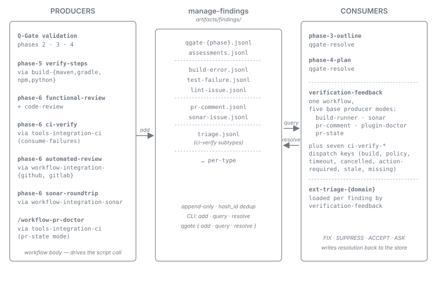

= Automatic Reviews
:nofooter:
:toc: left
:toclevels: 2

xref:../../README.md[Plan Marshall] » xref:README.adoc[Concepts]

Stock review processes ask the LLM to remember every comment, every Sonar issue, every CI failure on its way to merge. That memory is unreliable. Plan Marshall does not lean on it: every filed finding — a Q-Gate finding on the outline, a build error, a CI check that turned red, a Sonar issue, a PR review comment — becomes a row in one append-only store, is resolved through a documented resolution path, and ends in one of four documented resolutions. The next phase boundary actually reads the store before it advances.

== One mechanism, many producers

Eight review surfaces feed the pipeline. Seven are automatic — Q-Gate over outline and task plan, build / verify during execute, the two in-house reviews just before the PR, CI verify, automated PR-comment review, and Sonar roundtrip — and one is the on-demand `/workflow-pr-doctor` sweep. All eight write into the same JSONL store, and every finding filed there ends with one of four resolutions: `fixed`, `suppressed`, `accepted`, or `taken_into_account`. The Q-Gate and the two in-house reviews are analytical producers whose findings are resolved through `qgate-resolve`; every other surface flows through the per-finding triage envelope. The review recipes and the finalize security audit described further below are further producers on the same pipeline.

For the triaged surfaces the producer side is deliberately mechanical — build logs parsed by regex, Sonar issues fetched via REST, PR comments fetched through the provider abstraction. LLM judgement enters only at the triage step, after the finding is in the store. That separation is what makes review reproducible: a reviewer comparing two runs sees the *same* signals reach the same triage loop, in the same shape. The analytical surfaces — the Q-Gate and the two in-house reviews — are judgement by design. Their blocking findings are recorded in the same store before they are resolved, so the boundary gate reads them the same way; an advisory finding from the two in-house reviews is not filed, because a pending finding blocks the merge, and reaches the reader through the review step's recorded facts and the decision log instead.

Per-domain decision knowledge plugs in through the `ext-triage-{domain}` extension point — each domain bundle ships its own table mapping severity to outcome and its own suppression syntax. The triage workflow loads the right domain's standards at dispatch time, keyed by the finding's `file_path`. The orchestrator does not pick the rules; the domain that owns the file does.

[CAUTION]
====
**The four outcomes mean "addressed," not "the underlying issue went away."**

Only `fixed` removes the problem. `suppressed` puts an inline annotation in the source and explains why the warning is being told to stop. `accepted` documents a decision in the finding record without touching the code. `taken_into_account` records that the feedback shaped a higher-order change — typically an outline restructure or a scope adjustment. The boundary gate counts `pending` resolutions and refuses to advance while any remain; it does not relitigate whether the resolutions were the right calls. That stays the reviewer's job.
====

== The two reviews before the PR

Two finalize steps review the plan's own change before it is pushed, and each answers one question:

* **Functional review** (`default:functional-review`, `order: 6`) — *did the plan deliver what it was asked to deliver?* It grades every outline deliverable and success criterion against evidence, flags files no deliverable asked for, and checks the plan's own reports of its work (task notes, commit messages, decision-log entries) against what the change actually does.
* **Code review** (`default:code-review`, `order: 7`) — *is the change well made?* It reads every changed file whole and judges it against the review rules of the domains the change touches, the cross-cutting code-review spine, and the project's own conventions. Every finding names the rule it breaks, where, and the input or state under which it goes wrong.

Both run as an author pass followed by an independent verifier, and both follow one rubric: how a finding is graded, where a blocking finding loops back to, and when a round may close. A re-run after a fix commit reviews only what the fix touched, and a clean partial round is followed by a full closing round, so neither review reports clean on evidence that covered only part of the change. Each review is switched on its own setting — `functional_review` and `code_review` — so a project can run one without the other.

== On-demand review: recipe-code-review

The seven automatic surfaces above fire at a phase boundary, on a build, or on a CI/PR event without anyone asking. The link:../../marketplace/bundles/plan-marshall/skills/recipe-code-review/SKILL.md[`recipe-code-review`] recipe is the *on-demand* counterpart: a diff-aware structural/quality review the operator invokes (`/plan-marshall recipe=code-review`) over the current footprint, bounded to an optional path/file scope and an optional explicit base branch.

It is one more producer, not a replacement. The recipe emits its observations as `lint-issue` findings into the *same* `manage-findings` store and dispatches each to its domain `ext-triage-{domain}` extension — so an on-demand review flows through the identical triage envelope, four-outcome resolution model, and blocking-count gate as every triaged automatic producer. It complements the automated PR-comment review and the Sonar roundtrip rather than standing apart from them: the operator can ask for a focused structural pass at any point, and whatever it surfaces lands in the one store the next phase boundary reads.

The security sibling, link:../../marketplace/bundles/plan-marshall/skills/recipe-security-audit/SKILL.md[`recipe-security-audit`], is the same shape for the security lens — an on-demand producer emitting `bug` / `anti-pattern` findings into the same pipeline (see xref:security.adoc[Concepts › Security]). Its *automatic* counterpart, `default:finalize-step-security-audit`, runs the same engine at finalize on every plan that touched files, taking its place in the phase-6 step sequence at `order: 5` — after `finalize-step-simplify`, before the two pre-push reviews and `push`, ahead of the automated PR-comment review and the Sonar roundtrip. Like the recipe it emits `bug` / `anti-pattern` findings into the one store, so the proactive gate flows through the identical triage envelope and four-outcome resolution as every other triaged producer.

== Related

* link:../../marketplace/bundles/plan-marshall/skills/ref-workflow-architecture/standards/findings-pipeline.md[`findings-pipeline.md`] — canonical end-to-end pipeline: producer → store → consumer → gate, the per-phase blocking partition, and the `pending_findings_blocking_count` invariant.
* link:../../marketplace/bundles/plan-marshall/skills/manage-findings/SKILL.md[`manage-findings/SKILL.md`] — the unified store API, the 13 finding types, and the four resolution outcomes with their semantics (in `standards/jsonl-format.md` § Resolution semantics).
* link:../../marketplace/bundles/plan-marshall/skills/plan-marshall/workflow/verification-feedback.md[`verification-feedback.md`] — the unified triage envelope: the five producer modes (`build-runner`, `sonar`, `pr-comment`, `plugin-doctor`, `pr-state`) plus the seven `ci-verify-*` subtypes, with the producer-specific Step 1 work.
* link:../../marketplace/bundles/plan-marshall/skills/plan-marshall/workflow/triage.md[`triage.md`] — the shared per-finding FIX / SUPPRESS / ACCEPT / AskUserQuestion decision loop the envelope hands off to.
* link:../../marketplace/bundles/plan-marshall/skills/phase-6-finalize/standards/ci-verify.md[`phase-6-finalize/standards/ci-verify.md`] — the CI failure-mode taxonomy (build, policy, timeout, cancelled, action-required, stale, missing) with detection rules per row.
* link:../../marketplace/bundles/plan-marshall/skills/phase-6-finalize/workflow/functional-review.md[`functional-review.md`] and link:../../marketplace/bundles/plan-marshall/skills/phase-6-finalize/workflow/code-review.md[`code-review.md`] — the two pre-push reviews: what each examines, in what order, and how it records its outcome.
* link:../../marketplace/bundles/plan-marshall/skills/phase-6-finalize/standards/review-rubric.md[`review-rubric.md`] — the rubric both reviews share: grading, loop-back targets, the verifier questions, and the delta-then-closing-round rule.
* link:../../marketplace/bundles/plan-marshall/skills/automatic-review/SKILL.md[`automatic-review/SKILL.md`] and link:../../marketplace/bundles/plan-marshall/skills/phase-6-finalize/workflow/sonar-roundtrip.md[`sonar-roundtrip.md`] — the two external roundtrip workflows.
* link:../../marketplace/bundles/plan-marshall/skills/extension-api/standards/ext-point-triage.md[`ext-point-triage.md`] — per-domain triage extension contract.
* xref:tools-and-scripts.adoc[Concepts › Tools and Scripts] — why the producer-side integrations are scripts, not MCP tools.
* xref:audit-trail.adoc[Concepts › Audit Trail] — where findings, decisions, and resolutions land on disk.
* xref:skill-handling.adoc[Concepts › Skill Handling] — how `ext-triage-{domain}` skills load at triage time.
